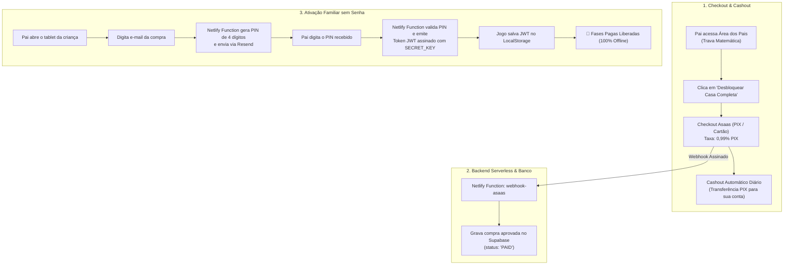

# 📋 Plano de Implementação: Monetização Web, Cashout e Licenciamento Seguro
## Soletrando o Mundo 🌍

---

### 🎯 Visão Geral e Objetivos do Sistema

Implementar um fluxo comercial completo de venda direta no site/PWA com:
1. **Zero Custo Fixo de Infraestrutura:** Uso de tecnologias gratuitas de alto desempenho (Netlify Functions, Supabase Free Tier, Resend Free Tier).
2. **Cashout Automático e Menores Taxas:** Recebimento via **Asaas** (PIX a 0,99% e cartão), com transferência diária automática para a conta bancária do criador.
3. **Segurança Anti-Burlas:** Validação criptográfica com **JWT assinado** por chave secreta de backend, impedindo que alterações manuais no `localStorage` liberem o jogo.
4. **Experiência Sem Senha (Zero Fricção para Crianças e Pais):** Ativação no tablet/celular apenas com o e-mail da compra e um **PIN Mágico de 4 dígitos**.
5. **Proteção Infantil Rigorosa (LGPD / Google Play Families):** Todo o fluxo financeiro fica protegido atrás da **Trava Parental Matemática**.

---



---

## 🏗️ Fases da Implementação

### FASE 1: Banco de Dados e Backend Serverless (Netlify Functions + Supabase)

#### 1.1 Configuração do Supabase (Banco de Dados Gratuito)
- Criar projeto gratuito no [Supabase](https://supabase.com).
- Criar a tabela `purchases`:
  ```sql
  create table purchases (
    id uuid primary key default gen_random_uuid(),
    email text unique not null,
    asaas_payment_id text unique,
    status text not null default 'PENDING', -- PENDING, PAID, REFUNDED
    amount numeric(10,2) not null,
    plan text not null default 'FAMILY_FULL_ACCESS',
    created_at timestamp with time zone default now(),
    updated_at timestamp with time zone default now()
  );
  ```
- Criar a tabela `magic_pins`:
  ```sql
  create table magic_pins (
    id uuid primary key default gen_random_uuid(),
    email text not null,
    pin_hash text not null,
    attempts integer default 0,
    expires_at timestamp with time zone not null,
    created_at timestamp with time zone default now()
  );
  create index idx_magic_pins_email on magic_pins(email);
  ```

#### 1.2 Criação das Netlify Functions (`netlify/functions/`)
- `netlify/functions/webhook-asaas.ts`:
  - Recebe notificações do Asaas (`PAYMENT_RECEIVED`, `PAYMENT_REFUNDED`).
  - Valida o cabeçalho `asaas-access-token` para evitar requisições forjadas.
  - Atualiza o status no Supabase para `PAID`.
- `netlify/functions/request-pin.ts`:
  - Recebe o e-mail digitado pelos pais.
  - Verifica no Supabase se existe compra com `status = 'PAID'`.
  - Se confirmado, gera um PIN numérico aleatório de 4 dígitos (ex: `7421`), grava o hash com validade de 15 minutos e despacha o e-mail via **Resend**.
- `netlify/functions/verify-pin.ts`:
  - Recebe `{ email, pin }`.
  - Valida tentativas (máximo 3 tentativas por PIN para evitar força bruta).
  - Gera e devolve um **JWT assinado com algoritmo HS256** contendo:
    ```json
    {
      "sub": "pai@email.com",
      "plan": "FAMILY_FULL_ACCESS",
      "iat": 1730160000,
      "iss": "soletrando-o-mundo"
    }
    ```

---

### FASE 2: Gateway Asaas & Cashout Automático

#### 2.1 Configuração da Conta Asaas
- Criação de conta PJ ou PF no Asaas (apenas documento e dados bancários).
- Geração da chave de API e do token de Webhook.
- Configuração do **Link de Pagamento / Checkout Transparente**:
  - Produto: *"Soletrando o Mundo — Acesso Familiar Vitalício"*.
  - Valor: R$ 29,90 (compra única).
  - Meios: PIX (código Copia e Cola + QR Code) e Cartão de Crédito.
- Configuração do **Cashout**:
  - Ativar transferência automática diária via PIX para sua conta de destino sem custo adicional.

---

### FASE 3: Lógica de Licenciamento no Front-end (`src/services/licenseService.ts`)

#### 3.1 Criação do Serviço de Licença
- Criar `src/services/licenseService.ts`:
  - `hasFullAccess(): boolean` — decodifica o JWT do `localStorage` e checa a assinatura localmente ou data de emissão.
  - `requestPin(email: string): Promise<{ success: boolean; message: string }>`
  - `verifyPin(email: string, pin: string): Promise<{ success: boolean; token?: string }>`
  - `activateLicense(jwtToken: string): void`
  - `revokeLicense(): void`

#### 3.2 Atualização da Política de Acesso aos Cômodos (`src/data/worldsData.ts`)
- Configurar os cômodos:
  - **Quarto (id: 1)** e **Cozinha (id: 2)**: `isFree: true` (Degustação gratuita para encantar as famílias).
  - **Sala (id: 3)**, **Banheiro (id: 4)**, **Jardim (id: 5)** e **Bônus (id: 6)**: `isFree: false` (Requer licença ativa).

---

### FASE 4: Componentes de Interface dos Pais (UI/UX)

#### 4.1 Modal de Compra e Oferta Familiar (`src/components/ParentPaywallModal.tsx`)
- Acessível **exclusivamente através da Trava Parental Matemática**.
- Apresentação acolhedora e ética:
  - *"Desbloqueie toda a Casa: 48 palavras, 6 cômodos e atualizações futuras"*.
  - Destaques: *Alinhado à BNCC, Zero Anúncios, Sem Mensalidades, Compra Única de R$ 29,90*.
  - Botão principal: **`[Desbloquear Casa Completa (R$ 29,90)]`** (abre o checkout do Asaas em nova aba segura).
  - Botão secundário: **`[Já comprou? Ativar neste aparelho]`** (leva ao modal de PIN).

#### 4.2 Modal de Ativação por PIN Mágico (`src/components/ParentActivateModal.tsx`)
- **Passo 1:** O pai digita o e-mail utilizado no pagamento. O sistema envia o PIN de 4 dígitos em segundos.
- **Passo 2:** O pai digita os 4 dígitos (`[ _ ] [ _ ] [ _ ] [ _ ]`).
- Ao confirmar:
  - Som de sino de celebração (`soundService.playFanfare()`).
  - Toast afetuoso: *"Licença Familiar Ativada com Sucesso!"*.
  - Todos os 6 cômodos liberam na hora.

---

### FASE 5: Verificação de Segurança, Testes e Auditoria

1. **Tentativa de Injeção no LocalStorage:**
   - Testar no DevTools a atribuição de tokens forjados ou falsos para garantir que o validador criptográfico rejeite tokens adulterados.
2. **Proteção de Força Bruta no PIN:**
   - Tentar digitar 4 PINs incorretos e validar se o sistema invalida a tentativa e exige um novo envio por e-mail.
3. **Simulação de Webhook do Asaas:**
   - Enviar requisições de teste simulando pagamentos aprovados e estornos (`REFUNDED`), certificando a revogação correta da licença.
4. **Funcionamento 100% Offline após a Ativação:**
   - Desligar a conexão Wi-Fi do tablet e comprovar que todos os cômodos desbloqueados permanecem jogáveis offline via Service Worker do PWA.

---

### ⏱️ Estimativa de Execução por Etapas

| Etapa | Escopo | Tempo Estimado |
| :--- | :--- | :--- |
| **Etapa 1** | Configuração do Supabase (SQL) e variáveis de ambiente | 30 min |
| **Etapa 2** | Desenvolvimento das 3 Netlify Functions (`webhook`, `request-pin`, `verify-pin`) | 2h |
| **Etapa 3** | Criação do `licenseService.ts` com validação de JWT | 1h |
| **Etapa 4** | Componentes React (`ParentPaywallModal` e `ParentActivateModal`) | 2h |
| **Etapa 5** | Testes de integração, segurança e fluxo ponta a ponta | 1h30 |
| **Total** | Sistema comercial completo pronto para faturar | **~7 horas de desenvolvimento** |
